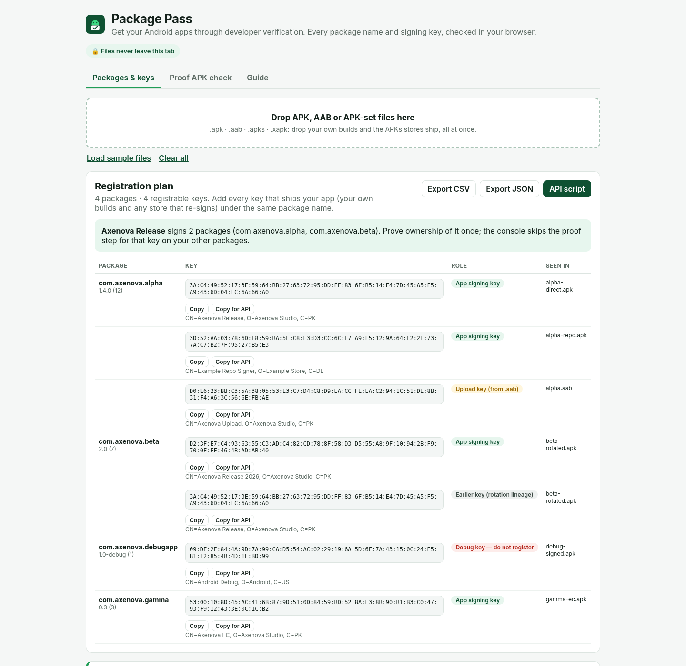
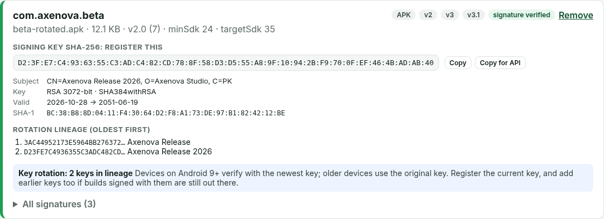
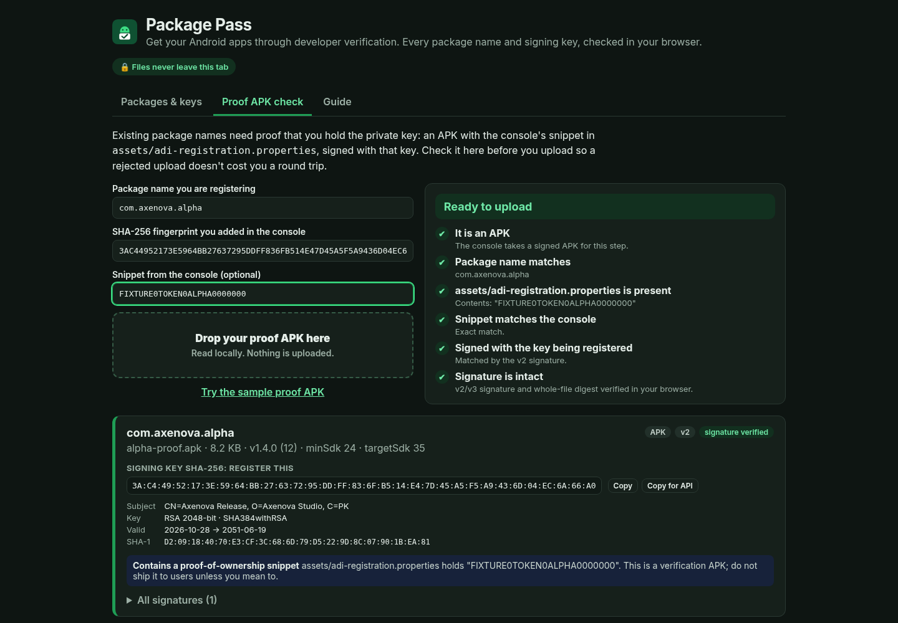

# Package Pass

**Get your Android apps through developer verification.** Drop in every APK, AAB and APK set you ship. Package Pass reads each package name and signing-key SHA-256 fingerprint in your browser and verifies the v2/v3 signatures. It works out which keys need registering for which packages, checks your proof-of-ownership APK before you upload it, and exports a plan as CSV, JSON or a Developer Console API script.

Your files never leave the tab. There is no backend, and a strict CSP blocks outbound requests.



## Why this exists

Android developer verification started on 30 September 2026. On certified devices (Android 7+) in Brazil, Indonesia, Singapore and Thailand, apps installed through participating stores (Google Play, Galaxy Store, HONOR App Market, OPPO App Market, Xiaomi GetApps, vivo V-Appstore, Palm Store) must be registered to a verified developer. Google plans to expand verification to certified devices worldwide in 2027. After that, installing apps from unverified developers outside the stores means the deliberately slow "advanced flow" or ADB.

Registering means adding **every package name** and **every SHA-256 key that signs it** in the Android Developer Console. For existing package names, you also upload a signed APK that proves you hold the key. That is easy for one app with one key. It gets hard when:

* the same app ships through Play, Galaxy Store, F-Droid or a direct download, and each channel may sign it with a different key;
* some apps rotated keys (v3 lineage), so older keys are still on users' devices;
* you only have the `.aab`, which carries your **upload** key rather than the key devices see;
* a debug or test build slips into the folder;
* you have dozens of apps, and copying fingerprints out of `apksigner` one at a time is slow and error-prone.

Existing tools are single-file fingerprint viewers or SDK command-line tools (`apksigner`, `keytool`, `aapt2`). Package Pass handles the whole release folder in one go, explains each key's role, and checks the proof APK before the console rejects it.

## Features

* **Batch inventory:** `.apk`, `.aab`, `.apks`, `.xapk`. Shows package, version, min/target SDK, signature schemes (v1/v2/v3/v3.1) and the fingerprint Android actually uses.
* **Real signature verification in the browser:** v2/v3 signed data and the whole-file chunked digest, using WebCrypto (RSA PSS/PKCS#1, ECDSA).
* **Registration plan:** grouped by package, with roles (*app signing key*, *earlier key from rotation lineage*, *upload key from .aab*, *debug key, do not register*). It also flags keys shared across packages, since a key only needs proving once.
* **Findings:** debug keys, `debuggable`/`testOnly`, v1-only or missing v1 for minSdk < 24, mismatched keys between schemes or split APKs, weak/DSA/expired certs, proof snippets left in a release build or placed at the wrong path.
* **Proof APK check:** confirms the package, `assets/adi-registration.properties`, the snippet, the signing key and signature integrity, with a single Ready / Not ready verdict.
* **Exports:** CSV (spreadsheet-formula safe), JSON, and a bash script for the [Developer Console API](https://developer.android.com/developer-verification/reference/developer-console-api). The script does a dry run by default and reads your OAuth token from the environment.
* **CLI** with the same engine for CI and release pipelines.
* Copy any fingerprint in colon format, or in the lowercase hex format the API returns.

| Artifact detail | Proof APK check |
| --- | --- |
|  |  |

## Quick start

Requires Node.js 22 (20.19+ works with an engine warning from Vitest).

```bash
git clone https://github.com/Ha2mad/package-pass.git
cd package-pass
npm install
npm run dev          # http://localhost:5173
```

Click **Load sample files** to try the bundled fixtures. They are signed with throwaway keys made for this repo.

Build a static site (deploy `dist/` anywhere, e.g. GitHub Pages or Cloudflare Pages):

```bash
npm run build
npm run preview
```

## CLI

```bash
npm run build
node dist-cli/cli.js scan ./release-builds              # human-readable report + plan
node dist-cli/cli.js scan app.apk store/app.apk --json   # machine-readable
node dist-cli/cli.js scan ./release-builds --csv plan.csv --plan-json plan.json --script register.sh
node dist-cli/cli.js scan ./release-builds --fail-on error   # exit 1 on debug keys, broken signatures…
node dist-cli/cli.js preflight proof.apk --package com.example.app \
  --fingerprint AB:CD:… --token-file snippet.txt         # exit 0 only when ready
```

Or install globally from a clone with `npm link`, then run `package-pass scan …`.

### Using the API script

```bash
export ACCESS_TOKEN=…            # user OAuth token, scope androiddeveloperconsole; never commit it
./register.sh accounts           # list your developer account ids
export DEVELOPER_ACCOUNT=1234567890
./register.sh                    # dry run: prints every request
RUN=1 ./register.sh              # registers packages and keys
```

Keys that come back in `DRAFT` state include a `verificationToken`. Put it in `assets/adi-registration.properties`, sign an APK with that key, check it in the **Proof APK check** tab, then upload it in the console.

## How it works

Everything is plain TypeScript with no native code. Only [`fflate`](https://github.com/101arrowz/fflate) (inflate) and [`preact`](https://preactjs.com) are used at runtime.

| Module | What it does |
| --- | --- |
| `src/core/zip.ts` | ZIP central directory reader |
| `src/core/sigblock.ts` | APK Signing Block, v2/v3/v3.1 parsing, proof-of-rotation, chunked digest + WebCrypto verification |
| `src/core/pkcs7.ts`, `x509.ts`, `asn1.ts` | DER, v1 JAR signatures, certificate details and fingerprints |
| `src/core/axml.ts`, `protoxml.ts` | Binary manifest (APK) and protobuf manifest (AAB) |
| `src/core/analyze.ts`, `findings.ts` | Per-artifact report and findings |
| `src/core/plan.ts`, `preflight.ts` | Registration plan, exports, proof APK checks |

## Development

```bash
npm run lint
npm test             # Vitest: core, plan/preflight and UI tests
npm run build        # typecheck + web build + CLI build
npm run check        # all of the above
```

Test fixtures in `tests/fixtures` are real APKs and AABs built with `aapt2` and signed with Android's own `apksig`, using throwaway keys. Expected fingerprints come from `keytool`. To regenerate them, you need the Android build tools (aapt2, `android.jar`, `apksig.jar`) in `$TOOLS`:

```bash
TOOLS=/path/to/tools scripts/fixtures/make-fixtures.sh
```

Only public certificates end up in the fixtures. The throwaway keystores are created in a temp directory and never committed (`.gitignore` also blocks `*.jks`, `*.p12`, `*.pem`, etc.).

README screenshots: `npm run build && npm run screenshots`. Set `CHROME_PATH` to use an installed Chrome instead of Playwright's download.

## Limitations

* **Not affiliated with Google.** Package Pass helps you prepare, but the Android Developer Console is the source of truth. Rules may change before the 2027 global rollout.
* An `.aab` only contains your **upload key**. With Play App Signing, get the app signing key from Play Console › App integrity, or scan an APK that Play delivered.
* v1 (JAR) signatures are parsed for certificates but not cryptographically verified. DSA and v4 / verity-only signatures are listed but not verified.
* ZIP64 archives (APKs over 4 GB) aren't supported.
* Rotation and store guidance is advisory. Whether a store re-signs your app depends on that store and your settings.

## License

MIT © 2026 Ha2mad
